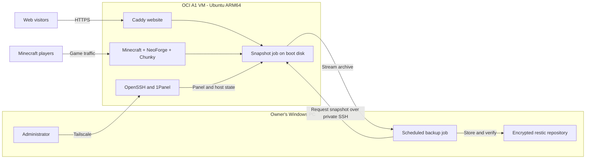

# Oracle Cloud Homelab

I designed, deployed and maintain an Oracle Cloud Infrastructure (OCI) homelab that hosts a static HTTPS website and a whitelist-only Minecraft server. The two services share one ARM VM and boot disk. A Windows PC pulls application data and host configuration over SSH and stores an encrypted recovery copy.

**Operational as of 18 November 2026.** Service checks included a public HTTPS request, a player joining Minecraft and a private administrative connection. I also restored and validated the backup archive.

## What it runs

| Layer | Implementation |
| --- | --- |
| Compute | OCI Ampere A1 Flex, 2 OCPUs and 12 GB RAM |
| Operating system | Ubuntu 26.04.1 LTS, ARM64 |
| Service management | Separate Docker Compose projects for the website and game, with 1Panel for administration |
| Website | Caddy serves static content over HTTPS and manages the site's TLS certificates |
| Minecraft | Minecraft 26.1.2, NeoForge 26.1.2.127, Chunky 1.5.66 and Java 25 |
| Administration | Tailscale and key-based OpenSSH |
| Storage and recovery | Approximately 50 GB of boot storage, bind-mounted service data and an encrypted restic repository on Windows |

I manage the host, network access, container images and game updates. I also maintain the backup job and its restore checks, including consistency checks on 1Panel's SQLite databases.

## Architecture

The Windows job requests a snapshot over Tailscale. The VM brings the game and panel back to their previous state before streaming the archive, so transfer time adds no service interruption. [Architecture and traffic flow](docs/architecture.md)

## Engineering decisions and lessons

- **Keep administration private.** Web visitors and approved players connect over the internet. I reach SSH and the panel through Tailscale.
- **Give gameplay priority.** Chunky pre-generates terrain within 1,000 blocks of spawn. A player joining paused generation, and the last player leaving resumed it.
- **Validate the restored data.** I restored the encrypted backup and checked 353 file hashes, seven SQLite databases, two TLS certificate/key pairs and the Minecraft world metadata. [Restore results](docs/operations.md#verification-and-restore)
- **Track costs on Pay As You Go.** I target Always Free usage and configured a €1 monthly budget with an actual-spend alert at 1%. [Billing configuration](docs/security-and-cost.md)

## Documentation

- [Architecture and traffic flow](docs/architecture.md)
- [Deployment overview](docs/deployment-overview.md)
- [Operations, backups and recovery](docs/operations.md)
- [Troubleshooting cases](docs/troubleshooting.md)
- [Security and cost controls](docs/security-and-cost.md)
- [Sanitized configuration examples](examples/README.md)

Configuration examples use placeholder names. I keep credentials, live endpoints and recovery archives private. The original documentation and examples use the [MIT license](LICENSE).
